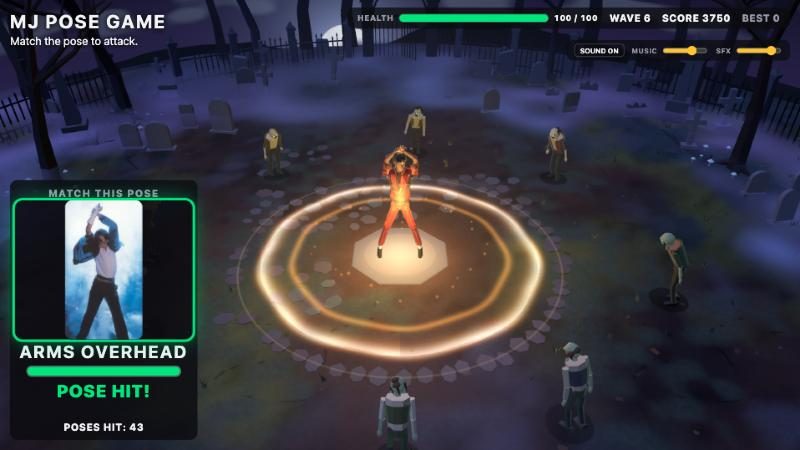
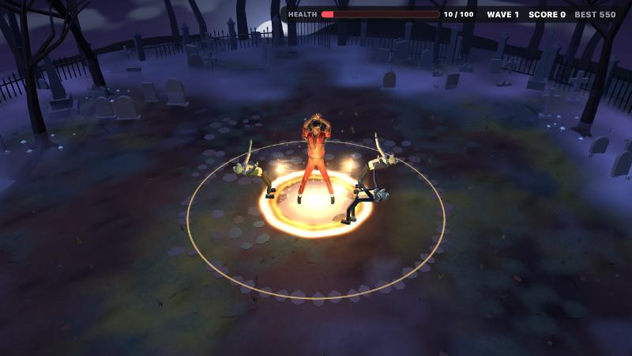
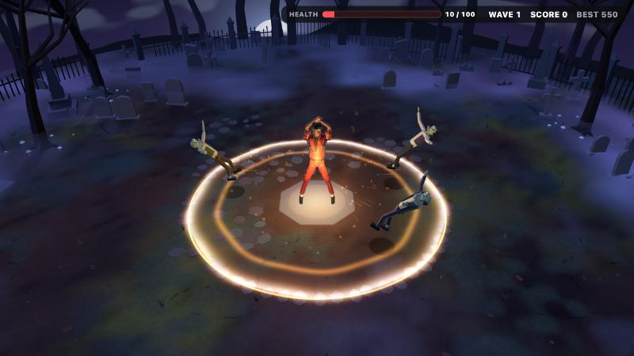
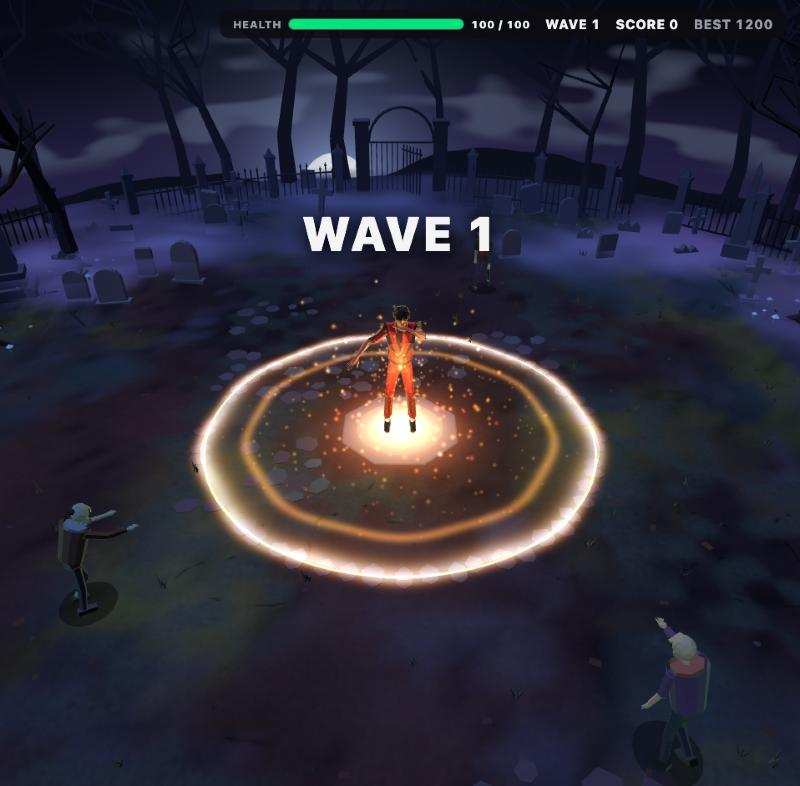
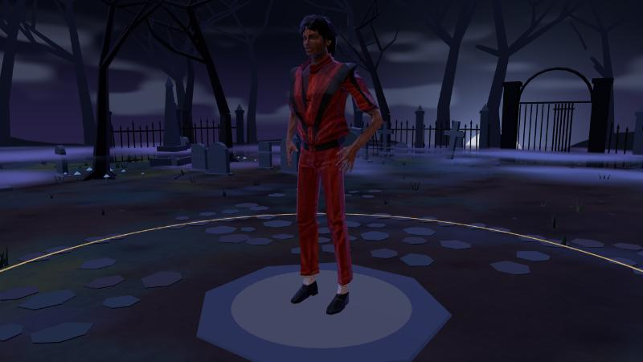

# MJ Thriller Pose Game

A browser game where your webcam becomes the controller. Copy iconic dance poses to unleash attacks against approaching zombies.



## Live Demo

**PLAY THE GAME:** _coming soon_ (link added when the site is deployed)

Requires a desktop browser with WebGL and a webcam. Developed and tested in Chromium-based browsers.

## Overview

MJ Thriller Pose Game is a browser-based webcam game where the player's body becomes the controller. The game shows a target pose, you copy it in front of your webcam, MediaPipe recognizes the pose in real time, and holding it for a moment triggers an attack against the zombies closing in on MJ in a moonlit cemetery. Survive wave after wave as the poses get harder.

Everything runs in the browser. The webcam video is processed locally; nothing is recorded, saved or uploaded.

## How It Works

```
Webcam
  ↓
MediaPipe Pose
  ↓
Pose Classifier
  ↓
Hold Confirmation
  ↓
Attack
  ↓
Zombie Knockback / Elimination
```

## Gameplay

1. Allow webcam access.
2. Look at the displayed pose.
3. Copy the pose.
4. Hold it briefly.
5. Successful recognition triggers an attack.
6. Survive increasingly difficult zombie waves.

### Controls / How to Play

- **Your body is the controller.** No keyboard or mouse is needed for attacks.
- Click **ENABLE CAMERA**, then **START GAME** (the click also enables sound in the browser).
- Stand back far enough that your shoulders, arms and hips are visible. Any pose can be done with either arm, facing the camera.
- Match the pose on the **MATCH THIS POSE** card and hold it until the bar fills (about half a second). Then the next pose appears.
- Zombies that reach MJ cost health. Each attack's shockwave knocks back and defeats the zombies in range.
- Sound: mute and volume controls are in the top-right corner.

The six poses in play: **Side Point, Face Cover, Diagonal Reach, History Stance, Smooth Criminal Lean, Arms Overhead.** Early waves ask for the easier ones; harder poses join as the waves progress.

## Features

- Webcam-controlled gameplay
- Real-time pose recognition with MediaPipe Pose, running entirely in the browser
- Custom pose classifiers with live coaching ("lean a little farther", "raise both hands above your head", …)
- MJ-inspired pose challenges with a difficulty curve and no back-to-back repeats
- Zombie survival waves with health, score and a saved best score
- A Three.js cemetery arena with fog, moonlight and a rigged 3D MJ who performs each pose
- Attack VFX: golden charge, shockwave rings, impacts, knockback and defeat effects
- Sound effects through the Web Audio API (attack voice, shockwave, hits, zombie groans)

## Screenshots

| Golden charge | Shockwave and knockback |
|---|---|
|  |  |

| Attack in the cemetery | The arena |
|---|---|
|  |  |

## Tech Stack

- **TypeScript**
- **Vite** (dev server and production build)
- **Three.js** on **WebGL** (3D arena, characters, VFX)
- **MediaPipe Pose** via MediaPipe Tasks Vision (Pose Landmarker, WebAssembly + GPU)
- **Web Audio API** (sound engine)
- Node.js built-in test runner

No backend: the game is a static site.

## Pose Recognition

1. **Detection.** The webcam stream runs through MediaPipe Pose Landmarker at about 20 detections per second, giving 33 body landmarks per frame.
2. **Body-relative measurements.** Landmarks become measurements such as arm direction, elbow angle, wrist height, reach and torso / leg lean, all scaled to the player's torso length. The same pose therefore reads the same close to or far from the camera, and for different body sizes.
3. **Classification.** Each pose is a classifier: a set of checks with tolerance ranges (for example, Smooth Criminal Lean looks for the whole body leaning sideways as one line, with the legs leaning too, so bending only at the waist doesn't count). Both arm assignments are tried, so mirrored poses count. Every failed check carries a coaching message shown on screen.
4. **Hold confirmation.** A pose must be held for 400 ms (short tracking dropouts up to 120 ms are tolerated) and released before it can count again. One confirmed pose = one attack.

### Architecture

- `src/pose/`: detection, body measurements, classifiers, hold state machine
- `src/game/`: pose registry, difficulty-weighted pose selection, game controller
- `src/survival/`, `src/combat/`: waves, health, score, shockwave combat
- `src/arena/`: Three.js scene. The MJ model is a static GLB that is rigged at load time (skeleton + skin weights) and animated with quaternion blends; zombies, cemetery, fog and VFX are generated in code.
- `src/audio/`: Web Audio engine and the event-to-sound director

## Running Locally

Requires [Node.js](https://nodejs.org/) 20.19+ or 22.12+.

```bash
git clone https://github.com/odhabit-sys/mj-thriller-pose-game.git
cd mj-thriller-pose-game
npm install
npm run dev
```

Open http://localhost:5173. The webcam needs `localhost` or HTTPS.

```bash
npm test               # automated test suite (249 tests)
npm run build          # type-check + production build into dist/
npm run preview        # serve the production build locally
npm run check:release  # release checks (assets, credits, no secrets)
```

With `npm run dev`, a live pose tester is available at `/?debug=true` (live measurements and the reason a pose isn't matching), plus a pose gallery at `/gallery.html` and a 3D model viewer at `/model-viewer.html`. These are development-only and not part of the production build.

## License

The original source code of this project is released under the [MIT License](LICENSE), Copyright (c) 2026 Reda Balkhity. You're welcome to use, copy, modify and build on it.

The MIT license applies to the project's own code only. It does **not** relicense third-party material included in or used by the project (the 3D model, libraries, and the Michael Jackson reference photos and sound clips), which keep their own licenses and rights. See [docs/CREDITS.md](docs/CREDITS.md).

## Third-Party Credits

- **3D character model:** ["Michael Jackson (Thriller)"](https://sketchfab.com/3d-models/michael-jackson-thriller-5747d705aeaf4c6fa3b3c50d01906ab8) by [MrLOCKiDY](https://sketchfab.com/MrLOCKiDY), licensed under [CC-BY-4.0](http://creativecommons.org/licenses/by/4.0/). Changes: the model file is unchanged; the game adds a skeleton and skin weights at load time and animates it.
- **Pose detection:** [MediaPipe](https://developers.google.com/mediapipe) by Google (Apache-2.0).
- **3D engine:** [three.js](https://threejs.org/) (MIT).
- **Pose card photos and sound clips:** Michael Jackson reference photographs, a short "hee-hee" voice clip, and sound effects (including a Minecraft damage sound by Mojang Studios) belong to their respective rights holders and are used without a license for this non-commercial fan project. They are not covered by this project's MIT license. Details and sources in [docs/CREDITS.md](docs/CREDITS.md).
- **Not included:** the "Thriller" recording. The public game plays without background music.

## Disclaimer

This is an unofficial, non-commercial fan project created for educational and entertainment purposes. Michael Jackson and related names, imagery, music, recordings, and other referenced material belong to their respective rights holders. This project is not affiliated with or endorsed by the Michael Jackson Estate or any associated rights holder.

Rights holders who would like any material removed can open an issue on this repository.
